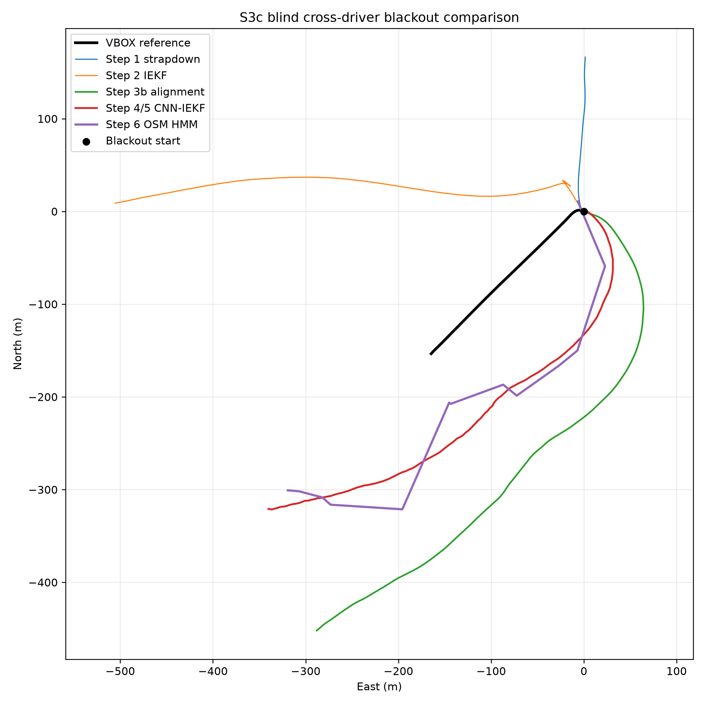
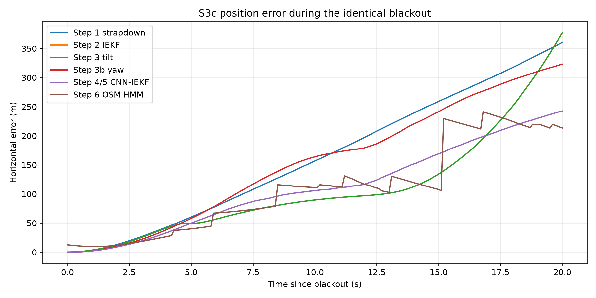
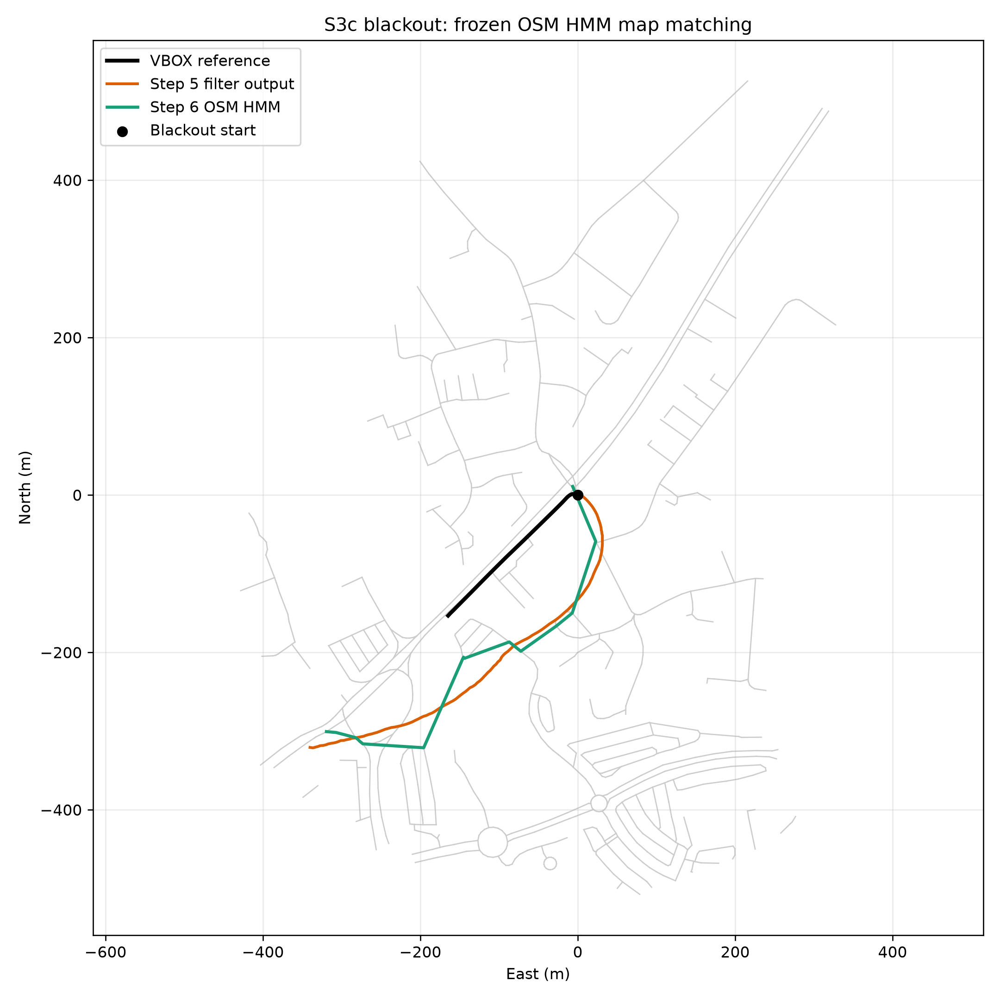

# S3c Blind Cross-Driver Confidence Test

This folder contains the frozen-pipeline evaluation on **S3c (Driver A)**. S3c was not used for
CNN training, validation, epoch selection, or Vta08 parameter tuning.

## Protocol

- Dataset: synchronized `S-S3c.csv` and `V-S3c.csv`
- Blackout: 2067.299–2087.299 s (20 seconds)
- Reference distance: 228.338 m
- Selection: earliest qualifying moving interval after stationary calibration
- Initialization: VBOX speed and heading at blackout entry only
- During blackout: VBOX is used only to calculate final evaluation metrics
- Parameters: existing Vta08 IEKF, CNN, alignment, and matcher settings frozen
- Leakage check: causal mounting-yaw window ends before blackout

The phone satellite parser was extended to recover spreadsheet-corrupted values such as
`May-23`, which represents the original `5 / 23` satellite-count field.

## Alignment

- Gravity tilt: roll +0.0048°, pitch -0.0010°
- Causal mounting yaw: +127.4112°
- Yaw window: 2063.5–2065.5 s
- Blackout begins: 2067.299 s
- S3c phone orientation was near Euler gimbal lock, so Android Euler yaw was not trusted.

## Cumulative results

| Step | Method | Endpoint error | RMSE | Drift |
|---|---|---:|---:|---:|
| 1 | Plain strapdown | 360.406 m | 196.178 m | 157.839% |
| 2 | Fixed IEKF + NHC | 377.357 m | 140.180 m | 165.262% |
| 3 | + gravity tilt alignment | 377.130 m | 140.101 m | 165.163% |
| 3b | + causal mounting yaw | 323.012 m | 184.599 m | 141.462% |
| 4 | + frozen CNN adapter | **242.498 m** | **131.434 m** | **106.201%** |
| 5 | GNSS suppressed during blackout | **242.498 m** | **131.434 m** | **106.201%** |
| 6 | + frozen OSM HMM map matching | **213.552 m** | 132.107 m | **93.524%** |

Step 5 equals Step 4 inside a synthetic blackout because there are no GNSS measurements to fuse.

## Interpretation

This run does **not** confirm cross-driver generalization. The CNN improves endpoint error by
80.513 m relative to the yaw-aligned IEKF and produces a trajectory whose direction is broadly
closer to the reference, but it still overestimates longitudinal travel severely. The resulting
106.201% drift is much worse than Vta08's 20.966% pre-map result.

After explicit approval, a 219 KB OSM extract was downloaded and the unchanged HMM parameters were
applied. Step 6 improves endpoint error by 28.947 m and drift by 12.677 percentage points, from
106.201% to 93.524%. Position RMSE worsens slightly by 0.674 m. Map matching constrains the
trajectory to roads but cannot repair the large unobserved longitudinal-progress error.

The result points to insufficient forward-speed/accelerometer-scale generalization across phone
mounts, drivers, and sessions. It supports expanding training across multiple drivers and adding a
learned velocity/displacement constraint rather than tuning S3c-specific filter parameters.

## Artifacts

- [Evaluation JSON](evaluation.json)
- [Cumulative trajectories](cumulative_trajectories.csv)
- [Cumulative metrics](../../metrics/S3c/cumulative_metrics.csv)
- [Cumulative trajectory plot](../../plots/S3c/cumulative_trajectory.png)
- [Position-error plot](../../plots/S3c/position_error_comparison.png)
- [OSM HMM comparison](../../plots/S3c/osm_hmm_comparison.png)

