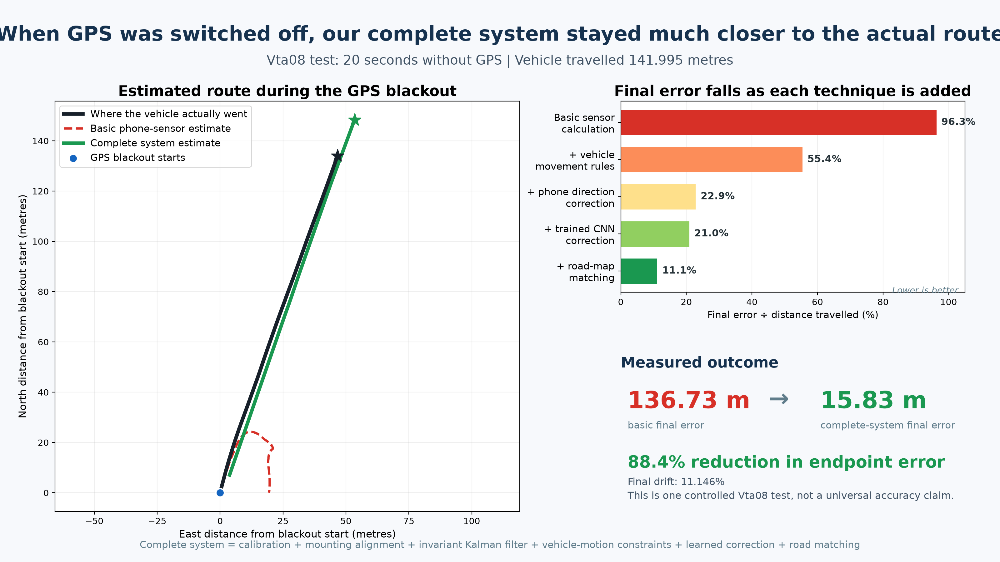
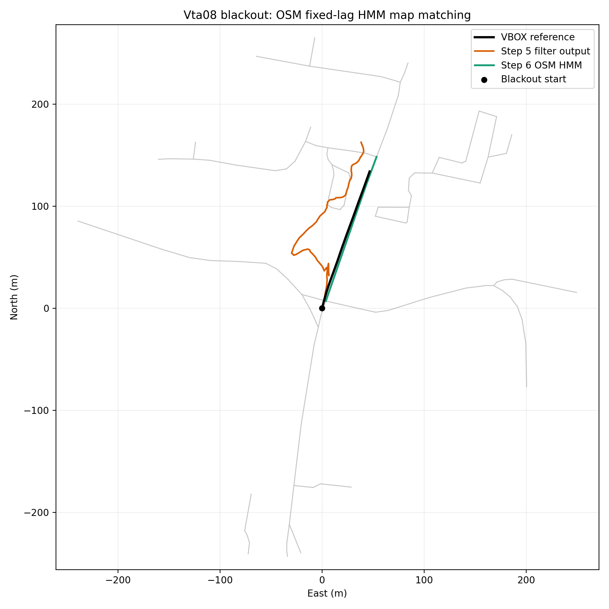
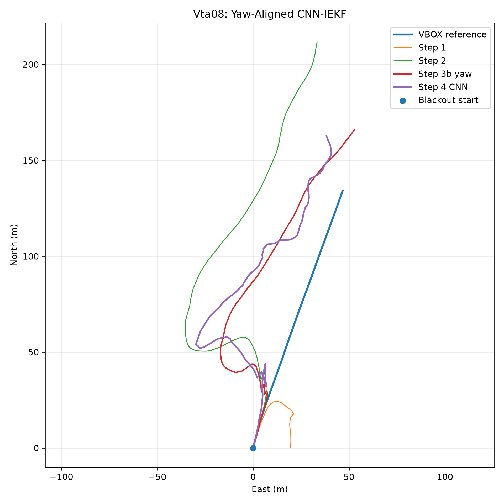
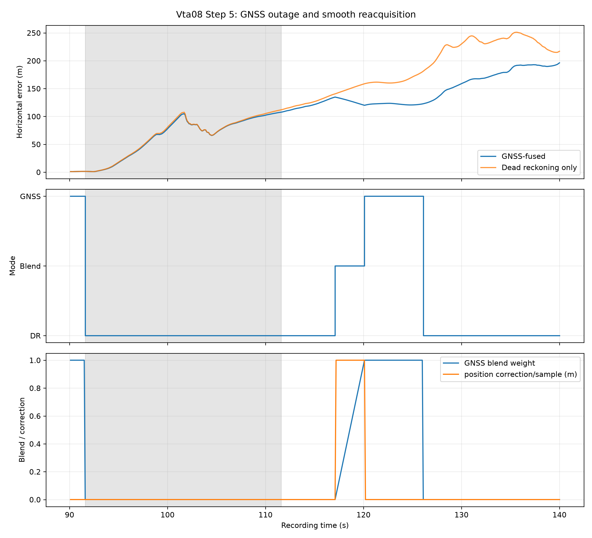
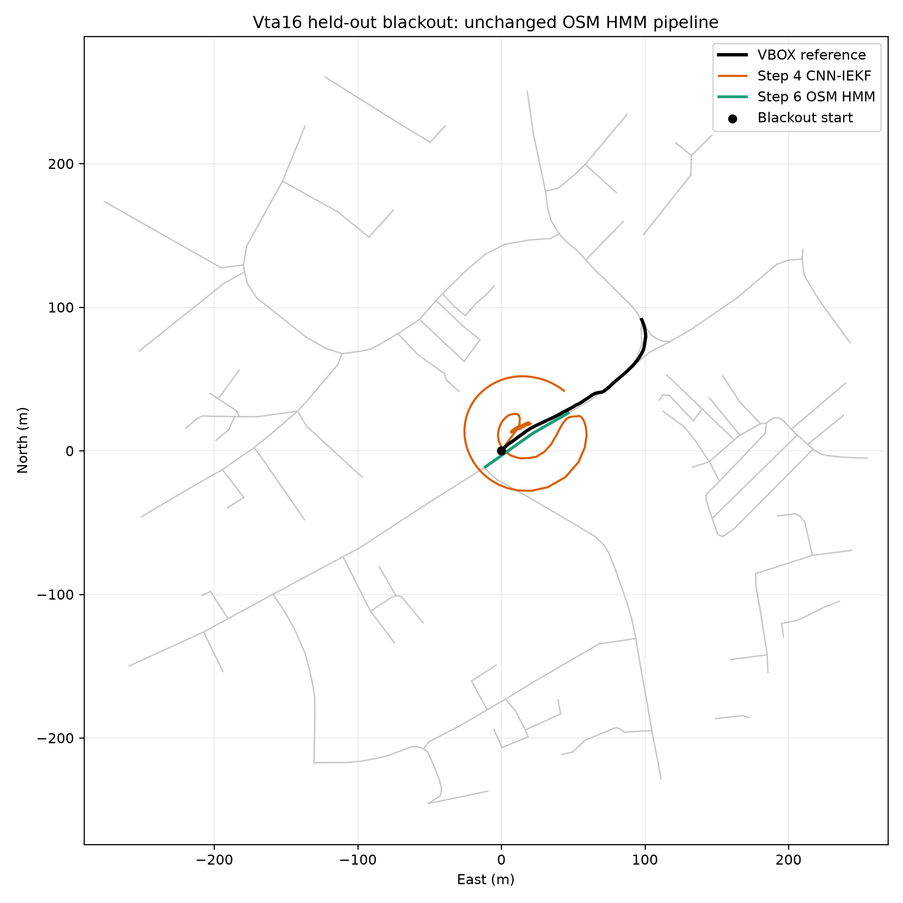

# Intelligent Dead Reckoning — Final Prototype Summary

Team ID: **SIH26_270**

Team: **Team Adhrit**

This folder is the single entry point for reviewing the current prototype. It summarizes what was
built, which techniques were used, the measured results, the correct interpretation of the final
11.146% Vta08 drift result, limitations, and links to the underlying evidence.

## Start here for the presentation



- [Open the judge-ready result image](judge_vta08_result.png)
- [Read the non-technical explanation and glossary](SIMPLE_EXPLANATION.md)

## Executive result

On the locked Vta08 simulated GNSS blackout from **91.6 s to 111.6 s**, the vehicle travelled
**141.995 m** over 20 seconds. The complete pipeline reduced endpoint position error from
**136.731 m to 15.827 m**, and drift from **96.293% to 11.146%**.

This is an **88.4% relative reduction in endpoint error** compared with plain strapdown INS.
It is close to, but does not yet satisfy, the problem statement's target of less than 10% drift.

> Correct claim: “On the Vta08 20-second, 141.995 m simulated GNSS blackout, the complete
> pipeline reduced endpoint drift from 96.293% to 11.146%.”

Do not describe 11.146% as a universal accuracy result. It is the result for one locked Vta08
blackout. Cross-session testing on Vta16 produced a weaker result, documented below.

## Is 11.146% produced only by Step 6?

**No. The 11.146% figure is the cumulative result of Steps 1–6 working together.**

Step 6 receives the trajectory already corrected by calibration, mounting-yaw alignment, the IEKF,
non-holonomic constraints, and the learned CNN adapter. It then applies the OSM HMM/Viterbi road
constraint.

The contributions must be stated separately:

| Attribution | Input drift | Output drift | Improvement |
|---|---:|---:|---:|
| Steps 1–5 together, before map matching | 96.293% baseline | 20.966% | 75.327 percentage points |
| Step 6 map matching alone, on the Step 5 output | 20.966% | 11.146% | 9.820 percentage points |
| Complete cumulative pipeline | 96.293% | 11.146% | 85.147 percentage points |

Therefore, map matching is responsible for the final reduction from **29.770 m to 15.827 m**
endpoint error. It did not independently take raw IMU data from 96.293% to 11.146%.

## Implemented architecture

```text
Smartphone IMU + phone GNSS + VBOX reference for offline evaluation
                              │
                              ▼
                Timestamp and unit validation
                              │
                              ▼
          Stationary bias estimation and gravity handling
                              │
                              ▼
        Phone-to-vehicle pitch/roll and mounting-yaw alignment
                              │
                 ┌────────────┴────────────┐
                 │                         │
                 ▼                         ▼
        Calibrated IMU              32 × 6 IMU window
                 │                         │
                 │                 Dilated CNN adapter
                 │              covariance + bias/scale
                 └────────────┬────────────┘
                              ▼
                  21-state SE2(3) IEKF
                              ▲
                              │
             Non-holonomic pseudo-measurements
             lateral velocity ≈ 0, vertical velocity ≈ 0
                              ▲
                              │
             Gated GNSS position/velocity updates
                              │
                              ▼
       GNSS_AIDED ↔ TRANSITIONING ↔ DEAD_RECKONING
                              │
                              ▼
              OSM HMM/Viterbi map matching
                              │
                              ▼
                  Final navigation trajectory
```

The CNN is not a direct position predictor. It produces bounded accelerometer/gyroscope bias and
scale corrections plus IEKF non-holonomic measurement-covariance scaling. Position, velocity, and
attitude remain filter states.

## Techniques implemented

### 1. Dataset validation and baseline INS

- Loaded synchronized IO-VNBD smartphone and VBOX recordings.
- Measured timestamps and sampling intervals rather than assuming a sensor frequency.
- Identified that the phone field labelled `GPS SPEED (Kmh)` behaves numerically like m/s.
- Defined device, vehicle, and ENU coordinate-frame transformations.
- Removed gravity, estimated stationary IMU biases, and built a plain strapdown baseline.
- Locked the Vta08 evaluation to the same 20-second blackout for every later comparison.

### 2. Fixed-covariance IEKF and vehicle constraints

- Implemented a 21-dimensional right-invariant error-state filter on SE2(3).
- State includes attitude, velocity, position, gyro bias, accelerometer bias, and car-to-IMU
  mounting extrinsics.
- Added non-holonomic pseudo-measurements constraining lateral and vertical vehicle velocity.
- Used fixed process and measurement covariances for the classical filter baseline.

### 3. Automatic mounting alignment

- Estimated pitch and roll from gravity during a detected low-yaw-rate window.
- Added a causal, pre-blackout GPS-heading/straight-acceleration window for mounting yaw.
- The Vta08 mounting-yaw estimate was **+13.537°**.
- The alignment uses no samples from inside or after the evaluated blackout.

### 4. Learned dilated CNN adapter

- Four causal Conv1d blocks with dilations 1, 2, 4, and 8.
- Input: 32 IMU samples × 6 gyro/accelerometer channels.
- Outputs: two covariance multipliers, three gyro-bias corrections, three accelerometer-bias
  corrections, and three accelerometer scale corrections.
- Parameter count: **10,411**.
- Checkpoint size: **52,386 bytes**.
- Measured desktop CPU CNN latency: median **0.131 ms**, p95 **0.230 ms** per window.
- Trained through the differentiable IEKF using relative position, velocity, and rotation losses.
- Drive split: Vta2 training, Vta16 validation/epoch selection, Vta08 named test.

### 5. GNSS fusion and mode arbitration

- Added GNSS position/velocity measurement updates to the same IEKF state.
- Added satellite-count, reported-accuracy, freshness, and chi-square innovation gates.
- Implemented `GNSS_AIDED`, `DEAD_RECKONING`, and `TRANSITIONING` modes.
- GNSS loss enters dead reckoning immediately.
- Reacquisition starts with zero blend weight and then applies capped corrections over three
  seconds, avoiding an immediate position jump.
- GNSS does not reduce drift while GNSS is absent. Its benefits are a cleaner state at outage entry
  and controlled recovery when fixes return.

### 6. OSM HMM/Viterbi map matching

- Parsed local OpenStreetMap XML extracts into drivable road graphs.
- Generated road-segment candidates using proximity and heading agreement.
- Used graph-distance, motion, direction, and road-turn transition scores.
- Applied fixed-lag Viterbi decoding rather than independent nearest-road snapping.
- Kept map matching downstream; it does not feed a correction back into the IEKF in this prototype.

## Vta08 cumulative comparison

Locked experiment: Vta08, 91.6–111.6 s, 20 seconds, 141.995 m reference distance.

| Step | Method | Endpoint error | RMSE | Drift | Interpretation |
|---|---|---:|---:|---:|---|
| 1 | Plain strapdown INS | 136.731 m | 65.015 m | 96.293% | Raw inertial drift baseline |
| 2 | Fixed IEKF + NHC | 78.723 m | 41.069 m | 55.441% | Filter and vehicle constraint help substantially |
| 3 | + gravity-based tilt alignment | 78.747 m | 41.128 m | 55.458% | Vta08 phone was already nearly level |
| 3b | + causal GPS-heading mounting yaw | 32.478 m | 35.013 m | 22.872% | Largest structural improvement |
| 4 | + dilated CNN adapter | 29.770 m | 27.845 m | 20.966% | Learned correction improves endpoint and RMSE |
| 5 | + GNSS fusion/arbitration | 29.770 m | 27.845 m | 20.966% | GNSS intentionally unavailable inside blackout |
| 6 | + OSM HMM map matching | **15.827 m** | **19.243 m** | **11.146%** | Best Vta08 cumulative result |

### Final Vta08 trajectory



Black is VBOX reference, orange is the Step 5 filter trajectory, and green is the final Step 6
map-matched trajectory.

### Learned adapter comparison



### GNSS loss and smooth recovery



## Cross-session result: Vta16

The exact Vta08 map-matching parameters were reused on Vta16 without session-specific tuning.
Vta16 was excluded from gradient updates but was used for Step 4 epoch selection, so it is a
validation session rather than a blind held-out test.

| Vta16 stage | Endpoint error | RMSE | Drift |
|---|---:|---:|---:|
| CNN-adapted IEKF before map matching | 73.397 m | 68.090 m | 50.558% |
| After OSM HMM map matching | 82.821 m | 63.177 m | 57.049% |

Map matching lowered RMSE by 4.913 m but worsened the final endpoint by 9.423 m. The HMM selected
the correct driven road but ended approximately **90.751 m behind** the correct longitudinal
position. This proves that road identification alone does not observe progress along a road and
that cross-session generalization is not established.



## Blind cross-driver result: S3c

The frozen pipeline was also run on **S3c (Driver A)**, which was not used for model training,
validation, epoch selection, or earlier parameter tuning. The deterministic selection rule chose
the earliest qualifying 20-second moving blackout after stationary calibration: 2067.299–2087.299
s, covering 228.338 m.

| S3c stage | Endpoint error | RMSE | Drift |
|---|---:|---:|---:|
| Plain strapdown | 360.406 m | 196.178 m | 157.839% |
| Fixed IEKF + NHC | 377.357 m | 140.180 m | 165.262% |
| + gravity tilt alignment | 377.130 m | 140.101 m | 165.163% |
| + causal +127.411° mounting yaw | 323.012 m | 184.599 m | 141.462% |
| + frozen CNN adapter | **242.498 m** | **131.434 m** | **106.201%** |
| + frozen OSM HMM map matching | **213.552 m** | 132.107 m | **93.524%** |

This is a failed generalization result, not a result to hide. Alignment and the CNN move the
trajectory toward the correct overall direction, while forward distance remains severely
overestimated. After explicit approval, Step 6 was run using a small public OSM extract. It improves
drift from 106.201% to 93.524%, but RMSE changes from 131.434 m to 132.107 m and the overall result
remains poor. Road constraints cannot recover unobserved longitudinal progress by themselves.

- [Complete S3c report](../experiments/S3c/README.md)
- [S3c evaluation JSON](../experiments/S3c/evaluation.json)
- [S3c cumulative metrics](../metrics/S3c/cumulative_metrics.csv)


## What has been achieved

- Built a reproducible hybrid classical/learned navigation pipeline rather than fabricating a
  low-error trajectory.
- Reduced the named Vta08 endpoint error by 120.904 m relative to plain integration.
- Demonstrated that phone mounting yaw was a major structural error source.
- Demonstrated differentiable learning through an IEKF without making the network directly emit
  navigation position.
- Demonstrated immediate GNSS-loss switching and non-jarring GNSS recovery.
- Demonstrated offline OSM map constraints using a temporal HMM/Viterbi matcher.
- Added automated tests covering preprocessing, coordinate frames, INS/IEKF operations, alignment,
  learned adapter behavior, GNSS gating, arbitration, evaluation, and map matching.

## Limitations and claims we must not make

- The less-than-10% target has not been reached: Vta08 is 11.146%.
- Vta16 does not generalize well and map matching worsens its endpoint result.
- The CNN is a dilated covariance/bias adapter, not the final requested CNN-GRU direct-speed model.
- The model is still a PyTorch checkpoint, not an INT8 TensorFlow Lite mobile model.
- Automated Zero-Velocity Updates are not implemented.
- Conditional neural inference based on degraded GNSS is not implemented on a phone.
- The Android sensor pipeline, map UI, power measurements, and real-time road tests remain open.
- The current experiments do not prove lane-level accuracy across drivers, devices, or routes.

## Recommended next validation

Freeze the current checkpoint, alignment logic, IEKF covariances, GNSS thresholds, and HMM
parameters. Run the complete Step 1–6 ablation on an untouched drive from another driver, preferably
**S1 (Driver A)** and then **M (Driver B)**. VBOX may define the blackout and compute evaluation
metrics, but it must not correct the state during the simulated outage.

For each new session, produce:

1. Plain INS, IEKF, alignment, CNN, GNSS/arbitration, and HMM results on the same blackout.
2. Endpoint error, RMSE, mean error, maximum error, distance, and drift percentage.
3. A cumulative trajectory plot and an error-versus-time plot.
4. A record of every frozen parameter and a clear disclosure of any failure.

After blind validation, the next implementation priorities are automated ZUPT, improved
longitudinal-progress map transitions, INT8 TensorFlow Lite export, GNSS-triggered neural inference,
and Android integration.

## Evidence and reproducibility links

- [Detailed cumulative results](../../docs/cumulative_results.md)
- [Step 1 baseline report](../../docs/baseline_vta08.md)
- [Step 2 IEKF report](../../docs/iekf_vta08.md)
- [Step 3 pitch/roll alignment report](../../docs/alignment_vta08.md)
- [Step 3b mounting-yaw report](../../docs/alignment_yaw_vta08.md)
- [Step 4 learned adapter report](../../docs/adapter_cnn.md)
- [Step 5 GNSS fusion report](../../docs/gnss_fusion_vta08.md)
- [Step 6 map-matching report](../../docs/map_matching_vta08.md)
- [Trained PyTorch CNN checkpoint](../models/adapter_cnn_v1.pt)
- [Step 4 evaluation JSON](../experiments/adapter_cnn/evaluation.json)
- [Step 5 evaluation JSON](../experiments/gnss_fusion_vta08/evaluation.json)
- [Vta08 Step 6 evaluation JSON](../experiments/map_matching_vta08/evaluation.json)
- [Vta16 Step 6 evaluation JSON](../experiments/map_matching_vta16/evaluation.json)

## Verification status

At the time this summary was prepared, the repository test suite contained **56 passing tests**.
All metrics in this report come from committed experiment artifacts; none are fabricated.
